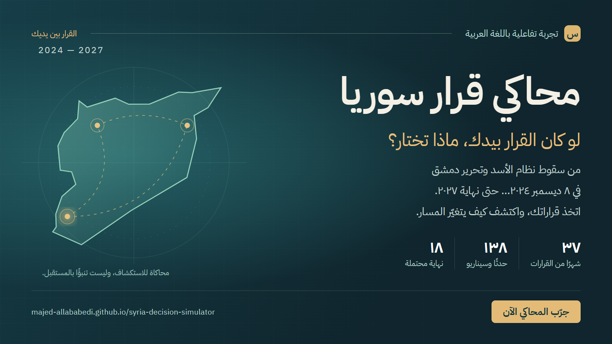

# محاكي قرار سوريا — من سقوط النظام إلى 2027



## منشور الإعلان

> من سقوط نظام الأسد وتحرير دمشق… إلى قرارات المستقبل 🇸🇾
>
> أطلقت «محاكي قرار سوريا»: لعبة عربية تبدأ في ٨ ديسمبر ٢٠٢٤، توازن فيها بين الأمن والاقتصاد والسيادة حتى نهاية ٢٠٢٧.
>
> لو كان القرار بيدك، ماذا تختار؟
>
> جرّبها وشاركنا نتيجتك 👇
> https://majed-allababedi.github.io/syria-decision-simulator/
>
> #سوريا

## الترخيص

هذا المشروع وقف لله تعالى، منشور بموجب **رخصة وقف العامة — الإصدار الثاني**، مع صون الحق الأدبي لأصحاب العمل.

- [النص الكامل للرخصة](LICENSE)، بما فيه المقدمة والتعريفات والحواشي، من [المصدر الرسمي لدى أعجوبة](https://ojuba.org/waqf-2.0:%D8%B1%D8%AE%D8%B5%D8%A9_%D9%88%D9%82%D9%81_%D8%A7%D9%84%D8%B9%D8%A7%D9%85%D8%A9).
- تسري رخصة وقف على العمل الأصلي للمشروع في حدود الحقوق التي يملكها أصحابه، ولا تعيد ترخيص مواد الأطراف الأخرى.
- يبقى خط **IBM Plex Sans Arabic** تحت [رخصة SIL Open Font License الأصلية](src/fonts/OFL.txt)، بما في ذلك نسخه المضمّنة في الملف النهائي والصورة الإعلانية.
- تبقى النصوص المقتبسة والمواد المرجعية وحقوق أصحاب المصادر خاضعة لتراخيصها الأصلية. الرسم المبسّط لسوريا مشتق من [بيانات world.geo.json](https://github.com/johan/world.geo.json/blob/master/countries/SYR.geo.json)، وهو رسم توضيحي لا خريطة حدود أو سيطرة.
- يُقدّم المشروع دون ضمانات وفق بند عدم المسؤولية في الرخصة؛ يرجى قراءة النص الكامل قبل الاستخدام أو إعادة التوزيع.

## عن المحاكي

لعبة قرارات عربية بملف واحد مكتفٍ ذاتيًا، تبدأ في **8 ديسمبر 2024** وتستمر **37 شهرًا** حتى ديسمبر 2027. تضم سياقًا تاريخيًا حتى نوفمبر 2026 وسيناريوهات مستقبلية معلنة؛ ليست كل رواية فيها مثبتة بالمستوى نفسه، وليست درجاتها قياسًا علميًا للواقع.

النسخة المحلية الجديدة تعتمد تصميم **غرفة القرار**: كحلي وحجري بلمسات نحاسية، وخط **IBM Plex Sans Arabic** مضمّن داخل الملف، ومؤشرات جانبية قابلة للطي. رابط اللعب أدناه يعرض النسخة المنشورة، ولا يتحدث تلقائيًا عند تعديل الملفات محليًا.

> ## ▶️ العب الآن مباشرة
> **https://majed-allababedi.github.io/syria-decision-simulator/**
> لا تنزيل ولا تثبيت: تفتح الرابط في أي متصفح (حاسوب أو هاتف) وتبدأ من 8 ديسمبر 2024.
> النسخة دون إنترنت: نزّل `index.html` من هنا وافتحه محلياً —
> https://github.com/Majed-allababedi/syria-decision-simulator/raw/main/index.html

## اللعب

### إحصاءات اختيارات اللاعبين

[صفحة الإحصاءات العامة](stats.html) تعرض أعداد الإجابات ونسبها لكل سؤال وتوزيع النهايات عبر العدّادات العامة في GoatCounter، دون مفتاح سري في الموقع.

- إرسال الاختيارات والنهايات اختياري، عبر مربع موافقة غير محدد مسبقًا؛ يمكن اللعب والاستئناف دون موافقة.
- يمكن سحب الموافقة أثناء اللعب أو من شاشة النهاية. يتوقف الإرسال اللاحق وتُلغى الطلبات المنتظرة؛ لا تُسحب الأعداد التي سبق إرسالها من المجموع العام.
- لا نرسل ملف الحفظ أو البذرة أو معرّف لاعب، ولا نرسل اختيارات سبقت الموافقة. تُطلب الموافقة من جديد بعد إعادة تحميل الصفحة.
- الأعداد تمثل اختيارات مسجّلة، لا أشخاصًا فريدين ولا استطلاعًا ممثلًا. تتأثر بالجولات المتكررة والتلاعب وحجب الإحصاءات، وقد تتأخر حتى أربع ساعات.
- تحتاج صفحة الإحصاءات إلى الإنترنت؛ لا تُرسل اختيارات النسخة المحلية أو المتصفحات التي تفعّل عدم التتبّع.
- `statsId` is part of an option's public counter identity. Keep it when reordering; use a new, unused ID if the choice changes meaning or its results must be counted separately. Never reuse a retired ID within the same event.

افتح `index.html` في أي متصفح (يعمل بلا إنترنت، ولا اعتماد على أي ملف خارجي)، أو استخدم الرابط أعلاه.

- اختر صعوبة + مستشارَين + **عقيدة حكم** (أضيفت عقيدة «المرجعية أولاً» لمسار الشريعة)، ثم قرّر كل شهر في حدث واحد.
- الأرقام التي تقرأها: **9 مؤشرات دولة** (شرعية، تماسك، أمن، اقتصاد، خدمات، جيش، سيادة، دبلوماسية، ديمقراطية)، **مؤشران سلبيان** (الضغط الإسرائيلي، الاحتقان الأهلي)، **خزينة** و**رصيد سياسي**، **8 علاقات خارجية**، **ثقة 6 مكونات**، **3 تهديدات** (داعش، الفلول، خطر الحرب).
- **محور الهوية: «مرجعية الشريعة في التشريع»** — لا يدخل مباشرة في أوزان الدرجة النهائية، لكنه يؤثر في مسارات ونتائج أخرى وفق افتراضات اللعبة. لا تمثل هذه الافتراضات جميع أفراد أي مكوّن. النص الدستوري المعتمد في البيانات: «الفقه الإسلامي هو المصدر الرئيسي للتشريع».
- **مجدول استحقاق**: أولوية الحدث ترتفع كلما اقتربت نافذته من الانتهاء، مع قرعة بسيطة تجعل كل حملة تسحب مجموعة مختلفة من الملفات؛ الصدمات لا تقع خارج نافذتها الزمنية.
- **سُلّم الشريعة**: ثلاث عتبات مقفلة (35/60/80) — التراجع عن استحقاق سبق إقراره يكلف رصيداً سياسياً واحتقاناً.
- **عدوى المكونات**: انهيار ثقة مكوّن أقلّي دون 20 ينزف التماسك والاحتقان شهرياً.
- **مرسوم اضطراري**: قرار لا يملك له رصيداً سياسياً يمرّ بثمن أعلى.
- **وعود سياسية**: بعض القرارات يُلزمك بوعد (مؤشر + عتبة + موعد). عند الموعد تُكافَأ أو تنكث فتدفع؛ وتُعرض التزاماتك المعلّقة مع قيمتها الحالية.
- **أثر مؤجّل وأقفال سردية**: 34 أثراً مؤجلاً و12 ملفاً يُفتَح بقرارك بعد أشهر.
- **عوائد متناقصة عند الأطراف**: رفع مؤشر فوق 70 أصعب، والانحدار تحت 30 أصعب — لا تشبّع ولا انهيار مفاجئ.
- **النتائج بالأدق**: النهاية الأنسب لحالتك تفوز، لا أول نهاية مطابقة في القائمة.
- تعرض القرارات كلفتها؛ وتعرض الخيارات الاحتمالية فرصة النجاح وثلاثة مستويات نتيجة. الخيارات الحتمية لا تتضمن قرعة.
- بعد القرار: مربع **«السياق المرجعي — ليس نتيجة قرارك»**، عندما يتوافر سياق في البيانات.
- الحفظ الجديد يحتفظ بالحدث الحالي ومرحلة النتيجة وحالة العشوائية، ولا يتجاوز قرارًا عند الاستئناف. تُحفظ النهاية أيضًا. الحفظ القديم أو غير الصالح يبقى دون استبدال صامت، مع تحذير واضح؛ لا توجد ترقية تضمن استمراريته الدقيقة.
- بعض القرارات تفتح مسارات لاحقة أو تُنتج **آثاراً مؤجلة** تظهر بعد أشهر.
- أطراف الجولة: **نهاية من 18 نهاية** (منها ثلاث نهايات لمسار الهوية: «دولة المرجعية»، «تسوية الهوية»، «الوعد الذي انقلب») + نتيجة من 100 + منحنى تطور المؤشرات + **تقرير قراراتك قابل للتحميل**.

## البنية
```
index.html            الملف النهائي (مبني، جاهز للنشر)
src/engine.js         محرك المحاكاة: حالة، انجراف شهري، احتمالات، انهيارات، تقييم
src/ui.js             الواجهة: شاشات، مستشيرون، عقائد، رسم منحنى، حفظ/استئناف، تقرير
src/css/style.css     تصميم غرفة القرار، عربي من اليمين إلى اليسار
src/fonts/            الخط المحلي بوزنين وترخيصه الأصلي
src/data/*.json       138 حدثًا (منها 26 صدمة) + 18 نهاية + 70 خبرًا شهريًا
                        منها 90-events-sharia-track.json: مسار تحكيم الشريعة (14 قراراً + 4 صدمات)
                        منها 95-events-gemini.json: 19 حدثاً أضافها بحث جيميني العميق، موسومة «مصدر واحد»
build.py              دمج المصادر إلى index.html + فحص بنيوي صارم
tools/test.js         اختبارات آلية: فحص بيانات + 400 جولة آلية (عشوائي/رشيد)
tools/smoke.js        اختبار تشغيل الواجهة بلا متصفح (DOM وهمي يلعب جولة كاملة)
tools/diag.js         تشخيص الاتزان: أي قرارات ترفع الاحتقان وأين يقع الانهيار
tools/track.js        قياس مسار «تحكيم الشريعة»: تكرار أحداثه، توزيع محور الهوية، نهاياته
docs/تقرير-سوريا-2024-2027-تحليل-شامل.md    التحليل البحثي الكامل (داخلي/خارجي + سيناريوهات)
research/00-بنك-الوقائع-الشهري.md            المرجع الزمني: تاريخ — واقعة — مصدر
research/01-مسار-تحكيم-الشريعة.md             دراسة مسار «تحكيم الشريعة»: الوعد، التنفيذ المؤجَّل، البنية القانونية الموروثة، الفاعلين
research/raw/                                 نصوص خام (ويكيبيديا عربي/إنجليزي) لكل واقعة مستعملة في المسار
v1/                     نسخة العمل الأولى (محفوظة للمقارنة)
```

## إعادة البناء والاختبار
```bash
python3 build.py            # يبني index.html ويتوقف عند أي خطأ في البيانات
python3 build.py --check    # يتحقق دون إعادة كتابة الملف النهائي
python3 tools/test-data.py  # اختبارات البيانات والبناء والخطوط
python3 tools/test-integration.py # اتساق النهايات وأعلام التشغيل
node tools/regression-core.js    # العشوائية والأشهر
node tools/regression-core-ui.js # الحفظ والاستئناف والتعامل مع الأخطاء
node tools/test-presentation.js  # النص العربي والتصميم
node tools/test.js 500 both # فحص بنيوي + 500 جولة آلية لكل أسلوب
node tools/smoke.js         # تشغيل الواجهة فعلياً بلا متصفح
node tools/diag.js 300      # تشخيص موازنة الأحداث
node tools/track.js 300     # قياس مسار الشريعة (تكرار أحداثه وتوزيع محور الهوية)
node tools/calib.js 1500 400  # معايرة كبرى: تقديرات، انهيارات، سلاسل زمنية، وعود، تغطية أحداث
```

## كيف تضيف حدثاً أو تغيّر توازناً
1. أضف كائناً في ملف `src/data/` المناسب (الشهر `month` من 0 إلى 36).
2. الخيارات: **2 على الأقل**، ولكل خيار إما `(eff + txt)` حتمي أو `prob` مع ثلاثة مخارج `ok/mid/bad`.
3. مفاتيح الآثار المسموحة: المؤشرات، `cash/cap`، `r_` للعلاقات، `p_` للمكونات، `t_` للتهديدات. أي مفتاح خاطئ يوقف البناء (لا صمت على الأخطاء).
4. شروط الظهور: `when: {flagAny, flagNone, flagAll, min, max, monthMin, monthMax}`.
5. الصدمات العشوائية: `"shock": true` مع نافذة عمر `ttl`.

## حدود النموذج
- لا يدّعي النموذج معرفة الغيب: ما بعد نوفمبر 2026 مسارات ممكنة، وتُعرض الأشهر المستقبلية بوصفها استشرافًا. وجود سياق تاريخي لا يجعل نتائج الخيارات الافتراضية وقائع.
- التدقيق الخارجي جزئي، ونتائجه الأولية ليست قائمة أخطاء مؤكدة. راجع وثائق الإصلاح وحدود التحقق قبل الاستناد إلى أرقام أو روايات بحثية.
- حُفظت النصوص الأصلية للمصادر وترخيص الخط كما هي؛ التعريب لا يعني تحريف الأدلة أو ترجمة معرّفات الشيفرة والروابط.
- الاحتمالات تقريبية ومبنية على اتجاهات موثقة، لا على معادلات إحصائية مدرَّبة.
- الأرقام العسكرية والضحايا تقديرات متعارضة المصادر؛ المدى أدق من الرقم المفرد.
- المحاكاة تُعلّم **تسلسل القرارات وكلفة التأجيل**، لا «الحل الصحيح».
